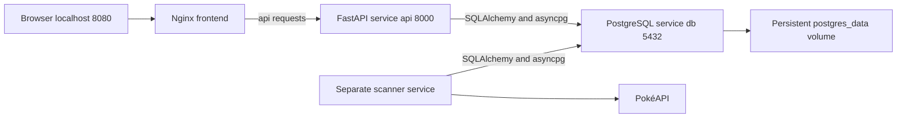

# PostgreSQL and Alembic walkthrough

PostgreSQL stores the application's durable data. Docker starts the PostgreSQL server,
Alembic upgrades the database structure, and SQLAlchemy connects Python application
code to the tables. These are separate responsibilities. Installing Python dependencies
with uv does not create a PostgreSQL server or its tables.

## What each component does

| Component | Responsibility in this project |
| --- | --- |
| PostgreSQL | Runs the database server, stores rows, enforces constraints, and supports transactions and locks |
| Docker Compose | Starts the database, API, frontend, and scanner and gives them a shared network |
| SQLAlchemy | Maps Python classes to tables and builds/executes queries and transactions |
| asyncpg | PostgreSQL driver used by SQLAlchemy for asynchronous network communication |
| Alembic | Applies versioned changes to the database schema and tracks the installed revision |
| uv | Resolves Python dependencies and creates the Python environment used by the API/scanner |

## Why the folder is called migrations

A database migration moves an existing database from one schema version to another.
For example, a later version might add a history table or a column while preserving
existing accounts and teams. That change is a migration even when its first version
simply creates tables in an empty database.

There are two related descriptions of our tables:

- `backend/app/db/models.py` contains the current SQLAlchemy models. These describe the
  table structure the Python application expects today.
- `backend/migrations/versions/` contains the ordered changes that produce that
  structure from previous versions. These are deployment history, not application data.

Our revision chain is:

1. `0001_accounts.py` creates account and access-token tables.
2. `0002_teams.py` creates Pokémon, teams, and ordered membership tables.
3. `0003_scan_history.py` adds scan audits, observed change history, and the active type
   chart, seeded with the previously observed type snapshot.

Each revision names its predecessor using down_revision and has upgrade/downgrade
functions. Alembic's own `alembic_version` table records the installed head revision.
Running `alembic upgrade head` applies only the revisions needed to reach the latest
head. If the database is already current, it does not recreate its tables.

A schema migration is different from a CatalogChange row. Alembic history records
structural changes to our application database. Catalog history records upstream
Pokémon/type data changing while the schema remains the same.

## Startup from a fresh checkout

The practical entry point is the repository's compose.yaml. Existing prepared images
can start with `docker compose -p pokemon-team-builder up -d --no-build`. A normal clean
checkout builds with `docker compose up --build`. This Windows-mounted workspace has
an unreadable host-cache metadata issue when building the backend directly; current
images have used a clean source copy under /tmp. That workaround does not alter the
service architecture or reuse host Python/Node environments.

1. Compose reads the ignored .env and substitutes configuration. It passes the database
   password to PostgreSQL and constructs DATABASE_URL for the API/scanner. The .env is
   not copied into the backend image or committed.
2. Docker starts the postgres:17 container. On an empty data volume, the official image
   initializes its storage, creates the pokemon role and pokemon database from the
   POSTGRES_* settings, and starts listening on port 5432.
3. PostgreSQL health checks pass. Compose then starts the API container. Inside its
   startup command, `alembic upgrade head` runs before Uvicorn starts.
4. Alembic reads alembic.ini, which points to migrations/. Its env.py reads DATABASE_URL,
   imports the models into Base.metadata, and uses an async SQLAlchemy engine to connect.
   The pending revisions execute their schema changes. A migration failure prevents
   Uvicorn from starting rather than serving against a mismatched schema.
5. Uvicorn starts FastAPI on port 8000. The API health check becomes available. The
   scanner waits for that health check before starting its own command.
6. The scanner runs `python -m app.jobs.scanner --schedule`, sharing the database and backend
   image but running in a separate container/process. It scans immediately and waits
   the configured interval after each completion. It does not run inside FastAPI.
7. Nginx serves React at localhost:8080 and proxies `/api` to the API service. The
   frontend's Compose dependency starts after the API container, but has no independent
   API-readiness condition; it can briefly return a proxy error during startup.

Full Pokémon ingestion is a separate data operation from schema creation. The initial
local catalog was explicitly imported and now contains 1,351 entries. The scanner can
populate a fresh catalog too, but importing the full catalog is not an Alembic revision.
Only the small historical type-chart baseline is seeded by migration 0003.

## Network and connection addresses

Inside the Docker network, db is a service hostname. The API uses a URL shaped like
`postgresql+asyncpg://pokemon:<password>@db:5432/pokemon`. The final pokemon is the
logical database name; postgresql+asyncpg selects the SQLAlchemy dialect and driver.
The database password is a credential, not a literal value to copy into documentation.

Inside an API container, localhost refers to that API container, not the database.
The default development Compose file does not publish the database port to the host.
A host-run Python backend therefore needs an explicitly reachable database address;
our isolated test Compose file publishes its disposable DB at loopback port 55432.

## How an API request reaches a row

For a team save, React sends the team name and complete ordered Pokémon ID list to
/api/teams. Nginx forwards the request to FastAPI. Authentication resolves the session
cookie to an account using the account tables. The route obtains an async SQLAlchemy
session from app/db/session.py, which uses an engine and connection pool.

SQLAlchemy builds SQL from the models and query expressions; asyncpg communicates it
to PostgreSQL. The route validates IDs, scopes the team by owner, locks its row for an
update, and replaces memberships in one transaction. Commit makes the new name and
lineup durable together. On an error, the transaction rolls back. The session closes
after the request; the engine can reuse a healthy pooled connection for later requests.

The scanner has a different connection lifetime. Its PostgreSQL advisory lock stays on
a dedicated physical connection for the whole scan. Short per-record transactions on
that same connection ensure a lost lock connection cannot silently continue writes.
A Pokémon update and its history insert commit together. A complete type-chart update
and all its associated type history commit together.

## What persists across restarts

PostgreSQL data lives in the named volume pokemon-team-builder_postgres_data. Replacing
an API/scanner container or changing Python tooling does not remove accounts, sessions,
teams, catalog records, scan audits, or history. Restarting PostgreSQL also reuses that
volume. POSTGRES_* initialization settings only initialize an empty volume; changing
a password in .env does not automatically change the password in an existing database.

The test stack uses a different project, pokemon_test database, and tmpfs storage.
Its tests use isolated schemas and its cleanup targets only that test project. Those
cleanup operations must never target the development volume.

## How to change the schema later

Edit the intended model, generate a candidate revision with
`uv run alembic revision --autogenerate -m "Describe the schema change"`, and review its
SQLAlchemy operations before applying it. Autogeneration is a draft: data backfills,
renames, and safe transformations can need manual work. Commit the model and migration
together, then test migrations and normal application behavior against PostgreSQL.

The current tests apply real revisions, compare schema metadata with models, and
exercise upgrade/downgrade using disposable databases. Downgrades are not a routine
way to refresh development data. Existing databases that predate Alembic need verified
baseline adoption; blindly stamping head could claim missing tables already exist.

See [Alembic's tutorial](https://alembic.sqlalchemy.org/en/latest/tutorial.html) and the
[PostgreSQL Docker image documentation](https://hub.docker.com/_/postgres) for the
underlying tools. The files linked above describe this project's actual configuration.
