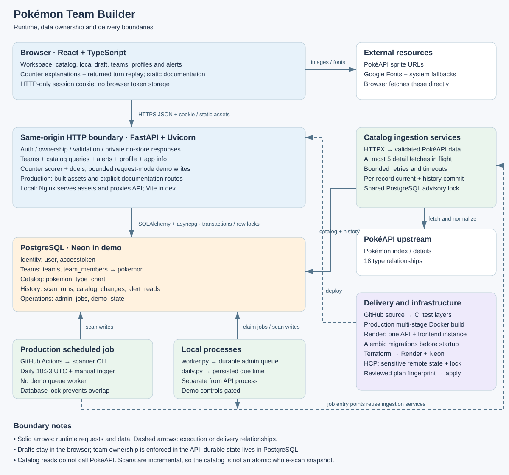
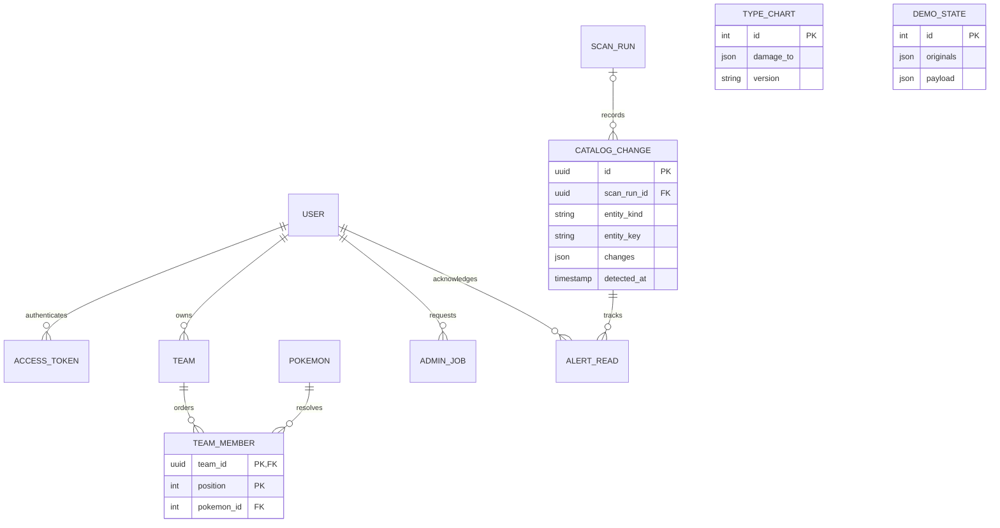

# Pokémon Team Builder Architecture

A technical walkthrough of the Pokémon Team Builder repository:
- What each subsystem does
- Why its boundaries make sense
- The assumptions behind its algorithms
- What I would change next

The application is a modular monolith with a separate ingestion process, built for a small, single-instance deployment. Its central promise is that users can edit durable teams against a locally available catalog, understand optimal counters, and see relevant source changes.

The implementation includes hosted request-mode demonstrations available to signed-in users; no shared reviewer login is required. The implementation and build journals establish the decisions described below. Where an original motivation is not recorded, the rationale is my engineering assessment of the design, not a claim about the original author's intent. This describes the working tree reviewed on October 21, 2026; hosting files describe intended configuration, not a fresh audit of live infrastructure.

Source links highlight exact lines at [reviewed commit 309f3c0](https://github.com/klimkw/pokemon-team-builder/commit/309f3c038a00fc34c1a63ef8fb67b550aa80e7c5), so later edits cannot silently move the referenced logic. They open GitHub in a separate tab in the app; private repository access requires a GitHub account with permission. Code excerpts below are copied from that revision. The reviewer-account retirement described here is a later local change; older pinned profile code still shows its former exception. Follow “Read the code” for context and the linked tests for executable evidence.

## 1. Product contract and assumptions

A team is an ordered list of zero to six Pokémon plus a name. Duplicates are allowed. An empty team is a valid saved draft, but a counter preview needs at least one member. Teams belong to accounts; the catalog and type chart are shared. Pokémon identity comes from PokéAPI IDs, including alternate forms, rather than an assumed contiguous National Pokédex range.

A saved team references current catalog records. It is not a snapshot of the stats that existed when saved. This keeps membership stable while upstream corrections become visible, but means a preview can change after a refresh. Alerts explain detected changes; they do not reconstruct historical team ownership or prove the exact time upstream changed.

See the [counter model guide](counter-model.md) for the generator's assumptions, worked example, limitations and definition of "optimal".

Read the code: [TeamWrite validation](https://github.com/klimkw/pokemon-team-builder/blob/309f3c038a00fc34c1a63ef8fb67b550aa80e7c5/backend/app/schemas/teams.py#L37-L45) · [ordered membership constraints](https://github.com/klimkw/pokemon-team-builder/blob/309f3c038a00fc34c1a63ef8fb67b550aa80e7c5/backend/app/db/models.py#L52-L59) · [counter request contract](https://github.com/klimkw/pokemon-team-builder/blob/309f3c038a00fc34c1a63ef8fb67b550aa80e7c5/backend/app/schemas/counters.py#L7-L9).

## 2. Technology choices and costs

| Layer | Repository choice | Why it fits and what it costs |
| --- | --- | --- |
| UI | React 19.2 and TypeScript 5.9 | Components and typed payloads suit an interactive editor. Types disappear at runtime; handwritten API types can drift from Python schemas. |
| Frontend toolchain | Vite 7.2, npm lockfile, Node 22.12 minimum | Fast local builds and a static demo bundle. The demo image uses Node 24 to build; Node is not in the serving runtime. |
| HTTP API | Python 3.12, FastAPI, Uvicorn, Pydantic schemas | Typed validation, dependency injection and generated OpenAPI keep a small API explicit. Async code still needs transaction and CPU-work discipline. |
| Authentication | FastAPI Users 14.0.2, cookie transport, database strategy | Delegates hashing and session lifecycle to a library. The username-to-email adaptation and library upgrade path are ongoing obligations. |
| Persistence | SQLAlchemy 2, asyncpg, PostgreSQL 17 in local Compose | Foreign keys, transactions, JSONB and locks enforce shared state. PostgreSQL is a real runtime dependency, not interchangeable with SQLite for scanning. |
| Migrations | Alembic | Versioned schema changes and repeatable startup. Rollbacks need schema compatibility planning. |
| Upstream client | HTTPX | Shared async client, bounded concurrency, timeouts and retry control. Upstream failure remains possible and must be represented. |
| Python packaging | uv and committed uv.lock | Locked installs reduce environment drift. Docker pins the uv binary image by digest. |
| Testing | pytest, Vitest, Testing Library, Playwright Chromium | Arithmetic, API behavior, UI state and browser integration are tested at different boundaries. No single layer establishes demo readiness. |
| Hosting and automation | Docker, Nginx locally, Render and Neon configuration, GitHub Actions | A small operational footprint with separate scheduled refreshes. Sleeping services and scheduler delays are accepted constraints. |
| Infrastructure | Terraform with HCP remote state and a pinned Render provider patch | Reviewable adoption of existing resources. Provider patch maintenance and sensitive state add operational work. |

Version ranges above describe the manifests, not a recommendation to upgrade to today's latest releases. Exact resolved dependency versions are in frontend/package-lock.json and backend/uv.lock.

There is no Redux, client query cache, runtime Markdown package, Redis, Celery, WebSocket service or microservice mesh. At this scale, adding each would create coordination work before solving a demonstrated bottleneck. The cost of the present simplicity is visible in the growing TeamBuilder component and manual request-state management.

Read the code: [frontend dependencies and scripts](https://github.com/klimkw/pokemon-team-builder/blob/309f3c038a00fc34c1a63ef8fb67b550aa80e7c5/frontend/package.json#L1-L37) · [Python dependencies](https://github.com/klimkw/pokemon-team-builder/blob/309f3c038a00fc34c1a63ef8fb67b550aa80e7c5/backend/pyproject.toml#L1-L33) · [build and runtime stages](https://github.com/klimkw/pokemon-team-builder/blob/309f3c038a00fc34c1a63ef8fb67b550aa80e7c5/Dockerfile.demo#L1-L23).

## 3. Repository map and dependency direction

| Location | Responsibility |
| --- | --- |
| frontend/src/main.tsx and App.tsx | React root, standalone documentation pages, session bootstrap and account shell |
| frontend/src/TeamBuilder.tsx | Catalog controls, draft editing, selection, saving and workspace coordination |
| frontend/src/api.ts | Shared HTTP transport, error translation and TypeScript request/response types |
| frontend/src/PokemonDetails.tsx and StatRange.tsx | Shared Pokémon visuals, stats, sprites and accessible range inputs |
| frontend/src/CounterPreview.tsx and BattleReplay.tsx | Explained preview, saving a new counter team and stepping through returned duel turns |
| frontend/src/Alerts.tsx, Profile.tsx and SessionRecovery.tsx | Change notifications, credential editing and draft-preserving reauthentication |
| frontend/src/AppInfo.tsx, ModelGuide.tsx and ArchitectureGuide.tsx | Metadata and repository-backed documentation |
| backend/app/main.py and frontend.py | Router assembly, private cache policy, engine cleanup and demo static serving |
| backend/app/api/ and schemas/ | HTTP authorization, validation and serialization boundaries |
| backend/app/services/ | Counter math, battle simulation, upstream normalization, persistence and alert relevance |
| backend/app/db/ | Models, sessions, URL/TLS adaptation and shared typing |
| backend/app/jobs/ | CLI ingestion, scans, durable queue processing, daily scheduling and admin/demo utilities |
| backend/app/ingest.py and scanner.py | Compatibility entry points for job commands |
| backend/migrations/ | Schema history and immutable seed data for the initial type chart |
| backend/app/data/ | Validated type-chart fallback and deterministic demonstration fixtures |
| backend/tests/, frontend/src/*.test.tsx and frontend/e2e/ | Backend, component and browser behavior tests |
| compose*.yaml, Dockerfiles and scripts/test* | Local runtime, isolated test runtime and demo packaging checks |
| infra/terraform/, scripts/terraform/ and .github/workflows/ | Infrastructure ownership, provider compatibility, CI and demo scans |
| README.md, CONTRIBUTING.md, AGENTS.md and docs/ | Reviewer overview, contributor/agent guidance, current runbooks, ADRs and archived build history |

The intended dependency direction is routes and jobs → services → database/upstream primitives. Services do not need an HTTP request to run. The pure counter scorer accepts data objects and a chart, which makes it independently testable. Some business transactions remain directly in route modules; that is tolerable here, but a future second API or CLI for team editing would justify extracting a team service.

Read the code: [API assembly](https://github.com/klimkw/pokemon-team-builder/blob/309f3c038a00fc34c1a63ef8fb67b550aa80e7c5/backend/app/main.py#L1-L67) · [request dependencies](https://github.com/klimkw/pokemon-team-builder/blob/309f3c038a00fc34c1a63ef8fb67b550aa80e7c5/backend/app/api/dependencies.py#L1-L10) · [database session lifecycle](https://github.com/klimkw/pokemon-team-builder/blob/309f3c038a00fc34c1a63ef8fb67b550aa80e7c5/backend/app/db/session.py#L1-L30).

## 4. Frontend walkthrough

### Application entry and navigation

main.tsx mounts App inside React StrictMode. App chooses the calculation guide or architecture page by pathname, otherwise renders WorkspaceApp. This is a deliberate small routing surface rather than a full router. The profile panel uses a URL hash. Adding many nested pages would make explicit routing and route-level code splitting worthwhile.

WorkspaceApp represents session state as checking, error, or ready with a user or null. This distinction matters: a failed network request must not masquerade as a confirmed sign-out. The initial /api/auth/me request is cancellable; abandoned responses cannot overwrite a later retry. Registration returns to sign-in, retaining the username and clearing the password. Login fetches the authenticated user after the cookie is issued.

Read the code: [React entry point](https://github.com/klimkw/pokemon-team-builder/blob/309f3c038a00fc34c1a63ef8fb67b550aa80e7c5/frontend/src/main.tsx#L1-L10) · [page dispatch and session states](https://github.com/klimkw/pokemon-team-builder/blob/309f3c038a00fc34c1a63ef8fb67b550aa80e7c5/frontend/src/App.tsx#L9-L75).

### Catalog workspace and visual elements

The catalog uses server-side name search, one or more type filters, any/all matching, stat ranges, stat sorting and bounded pagination. Searches debounce for 250 ms, and AbortController prevents superseded results from replacing current ones. Filter changes reset the page. Numeric sorting uses ID as a deterministic secondary key, avoiding arbitrary order for equal stats.

Pokémon cards share sprite, type badge and six-stat components with the editor and comparison views. That reuse makes the same stat mean the same thing in every context. Sprite images load lazily; a failed or absent image gets a visible placeholder. Their empty image alt text avoids repeating the adjacent Pokémon name. Type badges contain text as well as color, so color is not the sole signal.

StatRange uses two native range inputs with labels and constrained endpoints. Slider domains come from whole-catalog maxima with a floor of 255, so filtering does not unexpectedly shrink the scale. The backend still validates ranges: browser controls are convenience, not a security boundary.

The CSS establishes the shared visual vocabulary: Pokémon branding, type colors, cards, panels, dialogs, buttons, responsive grids and focus treatment. A header portal places workspace actions beside global App info. Desktop keeps the team near the catalog; the current editor measures its height so a tall lineup can scroll before sticking. Narrow layouts use a team dialog. These choices preserve access to a six-member lineup, but measurement logic and breakpoint behavior need browser-level regression coverage. External font and sprite loading can fail independently of the app; font fallbacks and image placeholders mitigate that dependency.

Read the code: [debounce and cancellation](https://github.com/klimkw/pokemon-team-builder/blob/309f3c038a00fc34c1a63ef8fb67b550aa80e7c5/frontend/src/TeamBuilder.tsx#L139-L171) · [SQL filtering and stable sorting](https://github.com/klimkw/pokemon-team-builder/blob/309f3c038a00fc34c1a63ef8fb67b550aa80e7c5/backend/app/api/catalog.py#L13-L65) · [shared cards and sprite fallback](https://github.com/klimkw/pokemon-team-builder/blob/309f3c038a00fc34c1a63ef8fb67b550aa80e7c5/frontend/src/PokemonDetails.tsx#L1-L37) · [paired range inputs](https://github.com/klimkw/pokemon-team-builder/blob/309f3c038a00fc34c1a63ef8fb67b550aa80e7c5/frontend/src/StatRange.tsx#L1-L19) · [responsive workspace styles](https://github.com/klimkw/pokemon-team-builder/blob/309f3c038a00fc34c1a63ef8fb67b550aa80e7c5/frontend/src/styles.css#L554-L1599).

### Draft ownership and saving

TeamBuilder separates saved teams from the editor's selected ID, name, members and baseline signature. The signature contains the name and ordered IDs, not all Pokémon stats. Consequently, an upstream stat refresh is not itself a user edit. Dirty drafts are held in React memory. Team switching, new-team actions and sign-out guard against discarding edits; beforeunload asks the browser to warn on refresh/close.

Save submits the entire ordered lineup. A synchronous operation ref supplements state-based disabling to prevent rapid repeated mutations before React rerenders. Failed saves preserve the draft. A team deleted elsewhere can be saved as a new team. The tradeoff is no offline persistence and no merge of two tabs' edits. A browser crash loses an unsaved draft; the unload warning is not a storage mechanism.

Read the code: [draft state and baseline](https://github.com/klimkw/pokemon-team-builder/blob/309f3c038a00fc34c1a63ef8fb67b550aa80e7c5/frontend/src/TeamBuilder.tsx#L15-L115) · [save and failure retention](https://github.com/klimkw/pokemon-team-builder/blob/309f3c038a00fc34c1a63ef8fb67b550aa80e7c5/frontend/src/TeamBuilder.tsx#L196-L222) · [draft behavior tests](https://github.com/klimkw/pokemon-team-builder/blob/309f3c038a00fc34c1a63ef8fb67b550aa80e7c5/frontend/src/TeamBuilder.test.tsx#L1-L264).

The dirty baseline compares the name and ordered IDs. It deliberately excludes catalog stats.

[Excerpt: draft identity](https://github.com/klimkw/pokemon-team-builder/blob/309f3c038a00fc34c1a63ef8fb67b550aa80e7c5/frontend/src/TeamBuilder.tsx#L19-L20)

```typescript
const signature = (name: string, members: Pokemon[]) =>
  JSON.stringify([name, members.map((pokemon) => pokemon.id)]);
```

### HTTP boundary and recovery

api.ts adds same-origin credentials, no-store requests, a 15-second timeout and caller cancellation. It translates known server errors into actionable messages. A non-authentication 401 emits a session-expired event; App overlays SessionRecovery while leaving TeamBuilder mounted. Successful recovery triggers a reload of saved data without intentionally replacing the editor draft.

This is an economical alternative to a global state/query framework. It also creates implicit coupling through a window event and some overly generic error messages: for example, the shared 404 message assumes a missing team. A timeout on a write does not prove the write failed; the server might have committed before the response was lost. Creation currently has no idempotency key, so blindly retrying can create duplicate teams.

Read the code: [HTTP transport and session-expired event](https://github.com/klimkw/pokemon-team-builder/blob/309f3c038a00fc34c1a63ef8fb67b550aa80e7c5/frontend/src/api.ts#L13-L78) · [recovery dialog](https://github.com/klimkw/pokemon-team-builder/blob/309f3c038a00fc34c1a63ef8fb67b550aa80e7c5/frontend/src/SessionRecovery.tsx#L1-L41) · [mounted editor and recovery overlay](https://github.com/klimkw/pokemon-team-builder/blob/309f3c038a00fc34c1a63ef8fb67b550aa80e7c5/frontend/src/App.tsx#L140-L156).

### Counter preview and replay

CounterPreview captures the editor's ordered IDs and asks the backend to resolve current catalog values. Opening it does not save or replace the team. It shows matched slots, type effectiveness, safe/risky classification and stat contributions. Saving the result is an explicit create operation. An unsaved draft can be previewed because the endpoint accepts IDs rather than requiring a persisted team ID.

BattleReplay steps through turn data returned by the server. It does not recalculate combat in JavaScript, which avoids two implementations disagreeing. A safe type matchup can still lose its illustrative duel: type safety is the optimizer's first objective, not a promise of simulated victory.

Read the code: [preview fetch and explicit save](https://github.com/klimkw/pokemon-team-builder/blob/309f3c038a00fc34c1a63ef8fb67b550aa80e7c5/frontend/src/CounterPreview.tsx#L20-L100) · [server-provided turn replay](https://github.com/klimkw/pokemon-team-builder/blob/309f3c038a00fc34c1a63ef8fb67b550aa80e7c5/frontend/src/BattleReplay.tsx#L1-L52) · [preview endpoint](https://github.com/klimkw/pokemon-team-builder/blob/309f3c038a00fc34c1a63ef8fb67b550aa80e7c5/backend/app/api/counters.py#L16-L28).

### Alerts and account panels

Alerts fetches a page and unread count, refreshes when saved memberships change, and supports acknowledgement. It displays before/after fields and histories, with manual demonstration changes distinguished from live data. Membership comes from saved teams, not unsaved editor choices. The popover manages positioning, outside interaction and focus return; these details are useful accessibility behavior but not a substitute for a full assistive-technology audit.

Profile requires the current password before a credential change. A password update revokes sessions and leads back through authentication. AppInfo fetches public metadata only when opened and exposes retry, source, repository, calculation and architecture links. Documentation links open a separate tab so reading them does not discard the current draft. This architecture page is bundled from one Markdown source and works without an API request or login.

Read the code: [alert fetch, acknowledgement and focus](https://github.com/klimkw/pokemon-team-builder/blob/309f3c038a00fc34c1a63ef8fb67b550aa80e7c5/frontend/src/Alerts.tsx#L17-L105) · [profile flow](https://github.com/klimkw/pokemon-team-builder/blob/309f3c038a00fc34c1a63ef8fb67b550aa80e7c5/frontend/src/Profile.tsx#L1-L58) · [App info and documentation links](https://github.com/klimkw/pokemon-team-builder/blob/309f3c038a00fc34c1a63ef8fb67b550aa80e7c5/frontend/src/AppInfo.tsx#L1-L53).

## 5. Authentication and trust boundaries

FastAPI Users owns registration, password hashing, random opaque token issuance, expiry validation and logout revocation. The cookie is HttpOnly, SameSite=Lax and configured Secure in demo, with a seven-day lifetime. JavaScript stores only the returned user in memory, not the session token. Database-backed sessions make immediate revocation straightforward at the cost of database lookups and retained token rows.

The library's internal email column contains the normalized username. The API exposes username; no real email address is collected. Usernames are 3–32 ASCII letters, digits or underscores and normalize to lowercase. Passwords are 8–128 characters. This avoids inventing a custom auth system, but the schema is semantically misleading. Email recovery or verification would require a deliberate model/API migration rather than treating existing values as addresses.

The built-in access-token table stores bearer tokens directly, not hashes. Database read access to active tokens is therefore security-sensitive. Logout revokes the presented session; changing the password deletes all the user's sessions. Expiry rejects an old token but does not clean up its row. Rate limiting, account recovery and expired-token cleanup remain backlog items.

Browser mutations reject an unexpected Origin and Sec-Fetch-Site: cross-site. Requests without those headers are permitted, allowing non-browser clients. Admin routes additionally permit the request base origin for same-origin Swagger use. This relies on correct proxy/host handling; the application does not itself install TrustedHostMiddleware. Before broader exposure, explicitly validate host/proxy trust and test CSRF behavior in the intended deployment.

Private route responses receive Cache-Control: no-store. Authorization derives ownership from the authenticated user, never a supplied user_id. An inaccessible team returns 404, so the response does not confirm another user's team exists. Full refresh and job history require an active superuser. Demo apply/reset require an active signed-in user and ENABLE_DEMO_CONTROLS; they change the shared catalog for everyone. A frontend hidden button would not be sufficient authorization.

The former shared reviewer login and its provisioning workflow have been removed. Migration 0006_retire_reviewer targets only its reserved UUID: it revokes sessions and privileges, cancels queued operations, and deletes the account if it owns no saved records. If teams, job history or read markers exist, the account remains inactive to preserve those records. A separately registered account named admin is not affected. This migration takes effect when the updated application is deployed and migrations run; repository changes alone do not prove a hosted account was removed.

Read the code: [cookie transport and database strategy](https://github.com/klimkw/pokemon-team-builder/blob/309f3c038a00fc34c1a63ef8fb67b550aa80e7c5/backend/app/api/auth.py#L44-L59) · [origin checks](https://github.com/klimkw/pokemon-team-builder/blob/309f3c038a00fc34c1a63ef8fb67b550aa80e7c5/backend/app/api/security.py#L5-L16) · [password change and token revocation](https://github.com/klimkw/pokemon-team-builder/blob/309f3c038a00fc34c1a63ef8fb67b550aa80e7c5/backend/app/api/profile.py#L37-L61) · [demo versus admin authorization](https://github.com/klimkw/pokemon-team-builder/blob/309f3c038a00fc34c1a63ef8fb67b550aa80e7c5/backend/app/api/admin.py#L80-L126).

The browser receives the token through the cookie transport; frontend JavaScript does not need to read it.

[Excerpt: server-controlled session cookie](https://github.com/klimkw/pokemon-team-builder/blob/309f3c038a00fc34c1a63ef8fb67b550aa80e7c5/backend/app/api/auth.py#L45-L47)

```python
cookie_transport = CookieTransport(cookie_name=COOKIE_NAME,
    cookie_max_age=SESSION_SECONDS, cookie_secure=COOKIE_SECURE,
    cookie_httponly=True, cookie_samesite="lax")
```

## 6. API contracts and transactions

| Route family | Access and behavior |
| --- | --- |
| GET /api/health | Public process liveness; does not test database readiness |
| GET /api/info | Public version, source, catalog count and successful live-refresh metadata |
| GET /api/pokemon and /api/pokemon/{id} | Public bounded catalog search and detail |
| POST /api/auth/register and /login; POST /logout; GET /me | JSON registration, form login, session revocation and session bootstrap |
| GET/POST /api/teams; GET/PUT/DELETE /api/teams/{id} | Owner-scoped list, create, read, whole-team replace and delete |
| POST /api/teams/counter-preview | Authenticated, side-effect-free calculation from 1–6 IDs |
| GET /api/alerts; POST /api/alerts/read | Owner-relevant recent history and acknowledgements |
| PATCH /api/profile | Current-password-verified credential change |
| POST /api/admin/refresh and /demo/*; GET /api/admin/jobs and /jobs/{id} | Superuser refresh/job inspection; signed-in demo apply/reset, additionally gated by configuration |

Pydantic schemas validate shapes, enums, bounds and relevant extra-field rejection. Database constraints defend core invariants even if a future writer bypasses a route. Create returns 201 with Location; queued admin operations return 202 with a status URL (request-mode demos return 200 with a terminal audit result); delete returns 204. A counter preview uses POST because it carries a structured lineup, even though it has no persistence side effect.

A team PUT first selects the owned row FOR UPDATE, validates Pokémon IDs, updates name/time, deletes old membership rows and inserts the new positions. It flushes and builds the response within the transaction, then commits. Delete/insert avoids primary-key collisions while swapping positions. A failed transaction rolls back both the name and lineup. The session is scoped to the request and successful writes explicitly commit.

The row lock serializes overlapping updates and deletion on the same team. It does not detect stale editing: the last successful save wins. If Alice opens two tabs, edits one, then saves the older other tab, that second coherent lineup can overwrite the first. Add a version column or ETag/If-Match with a conflict response when that product problem matters.

Relationships use lazy='raise' and explicit selectinload for team members and Pokémon. That makes accidental asynchronous lazy loading fail visibly and avoids a per-member query loop. Listing every team is currently unpaginated, acceptable for small accounts but a future size limit or pagination boundary.

Read the code: [owned lookup and row lock](https://github.com/klimkw/pokemon-team-builder/blob/309f3c038a00fc34c1a63ef8fb67b550aa80e7c5/backend/app/api/teams.py#L17-L24) · [whole-team save transaction](https://github.com/klimkw/pokemon-team-builder/blob/309f3c038a00fc34c1a63ef8fb67b550aa80e7c5/backend/app/api/teams.py#L72-L84) · [overlapping-save regression](https://github.com/klimkw/pokemon-team-builder/blob/309f3c038a00fc34c1a63ef8fb67b550aa80e7c5/backend/tests/test_concurrent_requests.py#L50-L68).

Ownership and optional locking are applied to the same query. The complete save function linked above uses this helper with lock=True.

[Excerpt: owned row lookup](https://github.com/klimkw/pokemon-team-builder/blob/309f3c038a00fc34c1a63ef8fb67b550aa80e7c5/backend/app/api/teams.py#L17-L24)

```python
async def owned_team(db: AsyncSession, team_id: uuid.UUID, user_id: uuid.UUID, *, lock=False):
    query = select(Team).where(Team.id == team_id, Team.user_id == user_id)
    if lock:
        query = query.with_for_update()
    team = await db.scalar(query)
    if team is None:
        raise HTTPException(404, "Team not found")
    return team
```

## 7. Database model and migrations

| Table | Keys and role | Design implication |
| --- | --- | --- |
| user | UUID account with library auth fields | Stable ownership independent of username changes |
| accesstoken | Opaque token with user FK and creation time | Revocable sessions; token rows are credentials |
| pokemon | Upstream integer ID, unique name, JSONB types/stats, sprite and synced_at | Flexible small nested payload; query hot spots may eventually need indexed/generated columns |
| teams | UUID, indexed owner FK, bounded name, timestamps | Parent lock is the serialization point for edits |
| team_members | Composite PK team_id + position, Pokémon FK; position 0–5 | Order and maximum positions enforced; repeated Pokémon remain possible |
| type_chart | Singleton id=1, multiplier matrix, version, synced_at | A single current ruleset with content identity |
| scan_runs | UUID, status, times, summary and bounded error | Audits success, partial failure, interruption and skipped overlap |
| catalog_changes | UUID, optional scan FK, entity kind/key, time, before/after JSON | Append-oriented observation history, separate from current records |
| admin_jobs | UUID, requester, action, payload, status, result and times | Database queue, no separate broker |
| demo_state | Singleton with originals and accumulated demo payload | Supports guarded reversal of demonstration changes |
| alert_reads | Composite PK user_id + change_id | Per-account read state without duplicating events per recipient |

Deleting a team cascades its membership, not catalog records. Pokémon deletion is restricted while referenced. Account deletion cascades owned records where configured, although account deletion is not exposed as a normal app feature. Events describe both Pokémon and types, so entity_key is polymorphic text rather than a direct Pokémon foreign key.

Alembic migrations 0001–0005 establish accounts, teams/catalog, scan history, admin jobs and alert reads. Migration 0006 retires the former shared reviewer login without deleting its saved records. The migration type-chart snapshot is separate from the application's current fallback: a historical migration must remain reproducible after runtime data changes. Stamping an existing schema is only safe after proving it matches the expected baseline; it is not a substitute for migrating an empty database.

PostgreSQL uses JSONB; tests can use SQLite JSON for portable behavior. SQLite foreign keys are enabled explicitly. SQLite does not establish PostgreSQL lock semantics, and the scanner explicitly requires PostgreSQL advisory locks. Hosted URL conversion uses asyncpg and certificate/hostname-verifying TLS for supported sslmode settings. A scanner needs a direct connection that preserves session advisory locks, not transaction-pooling semantics.

Read the code: [all table mappings and relationships](https://github.com/klimkw/pokemon-team-builder/blob/309f3c038a00fc34c1a63ef8fb67b550aa80e7c5/backend/app/db/models.py#L1-L126) · [team and catalog migration](https://github.com/klimkw/pokemon-team-builder/blob/309f3c038a00fc34c1a63ef8fb67b550aa80e7c5/backend/migrations/versions/0002_teams.py#L1-L41) · [history migration](https://github.com/klimkw/pokemon-team-builder/blob/309f3c038a00fc34c1a63ef8fb67b550aa80e7c5/backend/migrations/versions/0003_scan_history.py#L1-L56) · [hosted TLS conversion](https://github.com/klimkw/pokemon-team-builder/blob/309f3c038a00fc34c1a63ef8fb67b550aa80e7c5/backend/app/db/connection.py#L6-L23) · [migration tests](https://github.com/klimkw/pokemon-team-builder/blob/309f3c038a00fc34c1a63ef8fb67b550aa80e7c5/backend/tests/test_migrations.py#L1-L56).

## 8. Counter algorithm and exactness

For a candidate C and opponent O, outgoing effectiveness is the best single own-type attack against all O's defending types. Dual defenses multiply; attacking types do not multiply together. Incoming effectiveness reverses the roles. Alphabetical attack-type ordering gives deterministic explanations when multipliers tie.

The per-slot objective is lexicographic: maximize safe first, then type strength, then stats. A safe matchup has outgoing ≥ 2 and incoming ≤ 1. Type strength is outgoing minus incoming, represented internally in quarter units to make comparisons exact. Remaining ties choose the lowest Pokémon ID.

```text
ratio(a, b) = round_half_up(1000 * a / (a + b))
ratio(0, 0) = 500
attack_potential = max(ratio(C.attack, O.defense),
                       ratio(C.special_attack, O.special_defense))
durability = floor((ratio(C.hp*C.defense, O.hp*O.attack)
                  + ratio(C.hp*C.special_defense, O.hp*O.special_attack)) / 2)
speed = ratio(C.speed, O.speed)
stats_score = attack_potential + durability + speed
objective = (safe, 4*(outgoing-incoming), stats_score, -candidate_id)
```

Why is picking the best candidate independently for each slot exact? Candidate reuse is allowed, and there is no resource or synergy constraint linking slots. Each slot can simultaneously attain its own maximum safe value; among those choices, each can maximize its type score; then its stat score. Summing these independent maxima yields the lexicographic team optimum. Complexity is O(N × K) for N candidates and K ≤ 6 slots, plus catalog materialization and duel output. A distinct-species rule would break this proof and require an assignment/search formulation.

The API resolves opponents and candidates from one catalog SELECT, loads the current chart separately, and runs scoring in a threadpool to avoid doing the Python loop directly on the event loop. This improves responsiveness, not CPU parallelism guarantees. A chart version identifies type relations, not the complete catalog/model input. Because chart and Pokémon reads are separate and scanning commits records separately, the preview is not a transactionally versioned whole-catalog snapshot.

The duel chooses physical or special attack by the better attack/defense ratio, uses base HP with a floor of one, and computes floor(30 × attack × effectiveness / defense), with defense at least one. Nonimmune hits deal at least one damage; immunity deals zero. Higher speed strikes first, and a fainted defender cannot retaliate. Equal speed is simultaneous. It stops on a knockout, mutual immunity or 200 turns and reports a winner, draw or stalemate. None of this is the official damage formula.

Read the code: [type multiplication and best own-type attack](https://github.com/klimkw/pokemon-team-builder/blob/309f3c038a00fc34c1a63ef8fb67b550aa80e7c5/backend/app/services/counters.py#L33-L45) · [pair score and integer objective](https://github.com/klimkw/pokemon-team-builder/blob/309f3c038a00fc34c1a63ef8fb67b550aa80e7c5/backend/app/services/counters.py#L48-L84) · [independent-slot optimizer](https://github.com/klimkw/pokemon-team-builder/blob/309f3c038a00fc34c1a63ef8fb67b550aa80e7c5/backend/app/services/counters.py#L87-L116) · [duel resolution](https://github.com/klimkw/pokemon-team-builder/blob/309f3c038a00fc34c1a63ef8fb67b550aa80e7c5/backend/app/services/battle.py#L18-L50) · [exhaustive-assignment proof test](https://github.com/klimkw/pokemon-team-builder/blob/309f3c038a00fc34c1a63ef8fb67b550aa80e7c5/backend/tests/test_counters.py#L98-L117).

Candidate selection never removes an ID from the available pool. The negative ID supplies the deterministic final tie-break.

[Excerpt: independent slot selection](https://github.com/klimkw/pokemon-team-builder/blob/309f3c038a00fc34c1a63ef8fb67b550aa80e7c5/backend/app/services/counters.py#L95-L100)

```python
    # No shared resource constraint: selecting one candidate never removes it
    # from another slot. Independent lexicographic maxima maximize their sum.
    ids = [max(by_id, key=lambda identifier: (scorer(by_id[identifier], opponent).objective, -identifier))
           for opponent in opponents]
    scores = [scorer(by_id[identifier], opponent).objective for identifier, opponent in zip(ids, opponents)]
    objective = tuple(sum(score[index] for score in scores) for index in range(3))
```

## 9. Ingestion and scheduled work

PokéAPI is contacted by jobs, not by ordinary catalog requests. That makes browsing independent of upstream availability and gives the API stable local data. The tradeoff is staleness, which the UI and metadata must represent honestly.

The client discovers the complete paginated Pokémon index before writes, checking expected URLs, repeated links and count consistency. It fetches at most five details concurrently. Retryable transport errors, 429 and 5xx receive up to three total attempts with bounded backoff and Retry-After handling. Malformed data and nonretryable HTTP errors fail the record. Redirects are not followed. An excessive requested delay fails for later retry rather than hammering upstream.

Normalization validates ID, name, ordered types, all six distinct base stats and sprite URL. Unknown source fields are ignored. Each validated record is persisted in its own short transaction. Changed used fields and their history event commit together; initial inserts establish a baseline without a change event. Unchanged data updates synced_at, meaning last successful check rather than change time. Missing upstream IDs are reported on full scans but not automatically deleted, preserving team references.

This makes reruns idempotent with respect to unchanged values and limits a bad record's blast radius. It deliberately sacrifices all-or-nothing catalog refreshes: readers can see a mixture of old and newly refreshed records during a scan, and partial success is a first-class outcome.

All cooperating catalog writers share a PostgreSQL session advisory lock. Crucially, persistence uses the physical connection holding the lock. If that connection is lost, the scanner refuses transparent continuation without reacquisition; otherwise a pool reconnect could resume writes after another scanner became owner. Overlapping attempts are audited as skipped. This is cooperative coordination, not a database prohibition against arbitrary direct SQL writers.

Local Compose runs two distinct processes: worker.py consumes durable admin_jobs; daily.py checks persisted due time under the writer lock and performs periodic refreshes. Worker startup marks interrupted running jobs and owns a separate worker lock. Queue claims use FOR UPDATE SKIP LOCKED; contention on the scan lock requeues rather than losing the request. It is not an exactly-once broker: a crash after data writes but before job completion can leave an interrupted job whose effects already occurred.

Demo uses a daily GitHub Actions one-shot scan at 10:23 UTC, with workflow concurrency plus the database lock. The configured Render deployment contains no always-on queue worker. The working-tree request mode addresses that distinction: live-refresh HTTP calls return 409 directing the operator to Actions, while bounded demo operations execute in the request under the scan lock with a ten-second timeout and an AdminJob audit. A disconnected or stopped process can still leave effects and an interrupted audit; this is not a durable background executor. Worker mode remains the default and requires a running worker to consume accepted queue requests. The API's reported interval is configuration metadata, not a guarantee that Actions will start on time.

Read the code: [upstream validation](https://github.com/klimkw/pokemon-team-builder/blob/309f3c038a00fc34c1a63ef8fb67b550aa80e7c5/backend/app/services/pokeapi.py#L65-L81) · [retry loop](https://github.com/klimkw/pokemon-team-builder/blob/309f3c038a00fc34c1a63ef8fb67b550aa80e7c5/backend/app/services/pokeapi.py#L107-L123) · [bounded ingestion concurrency](https://github.com/klimkw/pokemon-team-builder/blob/309f3c038a00fc34c1a63ef8fb67b550aa80e7c5/backend/app/jobs/ingest.py#L37-L82) · [lock-owning connection](https://github.com/klimkw/pokemon-team-builder/blob/309f3c038a00fc34c1a63ef8fb67b550aa80e7c5/backend/app/jobs/scanner.py#L40-L60) · [scan lock lifecycle](https://github.com/klimkw/pokemon-team-builder/blob/309f3c038a00fc34c1a63ef8fb67b550aa80e7c5/backend/app/jobs/scanner.py#L64-L85) · [durable queue processing](https://github.com/klimkw/pokemon-team-builder/blob/309f3c038a00fc34c1a63ef8fb67b550aa80e7c5/backend/app/jobs/worker.py#L33-L81) · [daily due-time check](https://github.com/klimkw/pokemon-team-builder/blob/309f3c038a00fc34c1a63ef8fb67b550aa80e7c5/backend/app/jobs/daily.py#L13-L26) · [hosted schedule](https://github.com/klimkw/pokemon-team-builder/blob/309f3c038a00fc34c1a63ef8fb67b550aa80e7c5/.github/workflows/catalog-scan.yml#L1-L27) · [request-mode demo execution](https://github.com/klimkw/pokemon-team-builder/blob/309f3c038a00fc34c1a63ef8fb67b550aa80e7c5/backend/app/api/admin.py#L36-L77).

This block runs inside sync_record’s sessions.begin() transaction. The changed fields and their event commit together; an unchanged record only refreshes its checked time.

[Excerpt: catalog update and history event](https://github.com/klimkw/pokemon-team-builder/blob/309f3c038a00fc34c1a63ef8fb67b550aa80e7c5/backend/app/services/catalog_sync.py#L27-L34)

```python
        changed = bool(changes)
        if changed:
            for field, value in values.items():
                setattr(existing, field, value)
            session.add(CatalogChange(scan_run_id=scan_run_id, entity_kind="pokemon",
                entity_key=str(record.id), entity_name=record.name, changes=changes, detected_at=utc_now()))
        existing.synced_at = utc_now()
        return "updated" if changed else "unchanged"
```

## 10. History alerts and demo isolation

Alert relevance is computed against the current user's saved team members and types within a rolling window, default seven days. Pokémon events match IDs. Type events can affect a member's attack type or a defending-type column. One shared SQL predicate drives pages, unread counts and acknowledgements, reducing inconsistencies between the badge and displayed results.

The query counts relevant events in SQL and hydrates only the requested page plus histories for those page entities. It avoids loading all retained events to render one page. The remaining cost is unbounded field history for an entity inside the window, plus loading all of the user's memberships. Offset pagination can shift under new inserts; cursor pagination and history bounds would improve high-volume behavior.

This is read-time relevance, not recipient fan-out at ingestion. If a user adds a Pokémon today, recent events can become relevant even if it was not in their team when detected. Removing it can make those alerts disappear. That follows the current-membership contract, but should be revisited if the product wants historical notifications or guaranteed delivery.

Manual demos use explicit tagged history and record original values across cumulative changes. Reset restores tracked fields only when newer source values will not be overwritten, and removes tagged demo history rather than all live history. API and worker both gate demo controls. Demo mode labels a fixture environment; it does not by itself enable HTTP mutations. The legacy render.yaml disables demo controls, while the current Terraform working tree enables request-mode controls and keeps DEMO_MODE=false. Terraform is the intended owner for adopted demo resources; these two configurations therefore describe different operating choices. Review the applied configuration before assuming demos are disabled. In request mode, demo writes are the explicit exception to the otherwise separate catalog-job boundary; live PokéAPI ingestion remains outside the API.

Read the code: [relevance predicate](https://github.com/klimkw/pokemon-team-builder/blob/309f3c038a00fc34c1a63ef8fb67b550aa80e7c5/backend/app/services/alerts.py#L11-L23) · [bounded page and entity-history query](https://github.com/klimkw/pokemon-team-builder/blob/309f3c038a00fc34c1a63ef8fb67b550aa80e7c5/backend/app/services/alerts.py#L63-L113) · [demo reset conflict protection](https://github.com/klimkw/pokemon-team-builder/blob/309f3c038a00fc34c1a63ef8fb67b550aa80e7c5/backend/app/services/demo_controls.py#L110-L149) · [alert query-scope regression](https://github.com/klimkw/pokemon-team-builder/blob/309f3c038a00fc34c1a63ef8fb67b550aa80e7c5/backend/tests/test_alert_query_scope.py#L1-L54).

This predicate combines the observation window with Pokémon identity and attacking/defending type relevance. It is reused for pages, counts and read acknowledgements.

[Excerpt: shared relevance predicate](https://github.com/klimkw/pokemon-team-builder/blob/309f3c038a00fc34c1a63ef8fb67b550aa80e7c5/backend/app/services/alerts.py#L11-L23)

```python
def relevant_changes(pokemon_ids: set[int], types: set[str], since, now):
    """The same relevance predicate serves pages, counts, and acknowledgements."""
    defenses = [CatalogChange.changes[f'damage_to.{kind}']['before'].as_float().is_not(None)
                for kind in sorted(types)]
    return and_(
        CatalogChange.detected_at.between(since, now),
        or_(
            and_(CatalogChange.entity_kind == 'pokemon',
                 CatalogChange.entity_key.in_([str(key) for key in pokemon_ids])),
            and_(CatalogChange.entity_kind == 'type',
                 or_(CatalogChange.entity_key.in_(types), *defenses)),
        ),
    )
```

## 11. Deployment and operational tradeoffs

The demo multi-stage Dockerfile builds React with Node, installs locked Python runtime dependencies, copies only built frontend assets and backend runtime files, then runs as a non-root user. Alembic runs before Uvicorn accepts requests. This suits one instance where a separate pre-deploy migration stage is unavailable. Scaling replicas requires coordinating migrations separately and verifying connection budgets.

Demo FastAPI serves the frontend after API routes. It explicitly registers documentation page paths before the static mount, keeping unknown API and asset URLs as 404s. Local Nginx serves the bundle and proxies /api and API docs; its broader SPA fallback differs from demo. Vite supplies the development API proxy. All keep browser requests on one origin, avoiding an unnecessary CORS/token-storage design.

Terraform adopts the existing Render service and Neon project, with prevent_destroy and runner checks rejecting creation/deletion/replacement. Neon defaults are managed through its project resource rather than double-imported. HCP stores and locks state; GitHub Actions executes Terraform. State can contain credentials even when variables are marked sensitive. Plan fingerprints require the fresh apply plan to match the reviewed plan; they do not substitute for protecting workflow code and credentials.

The repository carries a narrowly scoped compatibility patch for a pinned Render provider's free-service update payload, with source checksum and serialization tests. This is justified as contained compatibility work, but is maintenance debt: remove it after validating an upstream fix. The configured checksPass deployment trigger must actually be applied to the service to affect releases, and manual deploys can bypass it. These are configuration semantics, not a claim that the hosted account currently enforces every gate.

Health is currently liveness only. There is no demonstrated availability SLO, restore drill, load capacity measurement or live authenticated deployment test. An image rollback does not undo an Alembic migration. Use backward-compatible migrations, preserve database recovery options, and treat backup restoration as a separate procedure to test.

Read the code: [demo Docker image](https://github.com/klimkw/pokemon-team-builder/blob/309f3c038a00fc34c1a63ef8fb67b550aa80e7c5/Dockerfile.demo#L1-L23) · [explicit documentation routes](https://github.com/klimkw/pokemon-team-builder/blob/309f3c038a00fc34c1a63ef8fb67b550aa80e7c5/backend/app/frontend.py#L7-L16) · [Nginx same-origin proxy](https://github.com/klimkw/pokemon-team-builder/blob/309f3c038a00fc34c1a63ef8fb67b550aa80e7c5/frontend/nginx.conf#L1-L24) · [Terraform resources and deletion protection](https://github.com/klimkw/pokemon-team-builder/blob/309f3c038a00fc34c1a63ef8fb67b550aa80e7c5/infra/terraform/main.tf#L1-L57) · [reviewed-plan runner](https://github.com/klimkw/pokemon-team-builder/blob/309f3c038a00fc34c1a63ef8fb67b550aa80e7c5/scripts/terraform/demo.py#L1-L214) · [provider compatibility patch](https://github.com/klimkw/pokemon-team-builder/blob/309f3c038a00fc34c1a63ef8fb67b550aa80e7c5/scripts/terraform/provider-patches/render-free-tier.patch#L1-L15).

## 12. Testing and what the evidence means

Pure backend tests cover scoring, tie breaks, integer rounding, simulation, normalization and retries. API tests cover ownership, validation, transactions, sessions, profiles, alerts and jobs. PostgreSQL-specific tests establish JSONB, advisory-lock and row-lock behavior, including overlapping writes. Alembic tests exercise migration paths. SQLite provides fast portable coverage but cannot certify the PostgreSQL behaviors.

Vitest and Testing Library cover user-visible component states with controlled API responses: draft retention, retries, disabled actions and recovery. Playwright adds Chromium desktop/narrow-screen journeys. Some layout tests mock the API; full-stack tests use Nginx, FastAPI, PostgreSQL and a worker with synthetic catalog data. A narrow Chromium viewport is not Safari/mobile-device coverage.

The full test script isolates its database/network and guards against pointing at development data. The demo-image script tests the real Dockerfile and startup migrations against an empty disposable PostgreSQL database, including direct page links and HTTP flows. It checks Secure cookie attributes but replays the cookie over the isolated HTTP transport; it does not prove public TLS termination. Infrastructure tests separately cover provider payloads, configuration and runner policy.

Historical counts and coverage in docs/testing.md are dated evidence, not a claim that this working tree has just passed every suite. Coverage identifies missing branches; it cannot establish correctness, security or capacity. Changes to these guides require rendering, navigation, direct-route and compilation checks. The reviewer-account retirement also requires migration tests against PostgreSQL; see the current testing guide for submission validation results.

Read the code: [isolated application suite](https://github.com/klimkw/pokemon-team-builder/blob/309f3c038a00fc34c1a63ef8fb67b550aa80e7c5/scripts/test.sh#L1-L35) · [demo image smoke suite](https://github.com/klimkw/pokemon-team-builder/blob/309f3c038a00fc34c1a63ef8fb67b550aa80e7c5/scripts/test-demo.sh#L1-L20) · [CI jobs](https://github.com/klimkw/pokemon-team-builder/blob/309f3c038a00fc34c1a63ef8fb67b550aa80e7c5/.github/workflows/tests.yml#L1-L39) · [database isolation and guards](https://github.com/klimkw/pokemon-team-builder/blob/309f3c038a00fc34c1a63ef8fb67b550aa80e7c5/backend/tests/conftest.py#L29-L85) · [full-stack recovery scenarios](https://github.com/klimkw/pokemon-team-builder/blob/309f3c038a00fc34c1a63ef8fb67b550aa80e7c5/frontend/e2e/session-recovery.spec.ts#L1-L38).

## 13. Request traces and failure semantics

### Save an existing team

1. The user edits local draft state; no write occurs yet.
2. Save sends name and ordered IDs with the existing session cookie.
3. FastAPI validates the origin, session and payload, then locks the owned team row.
4. The transaction validates catalog references and replaces the lineup atomically.
5. On success the UI adopts the saved result and updates its baseline; on failure the draft stays.
6. If the response is lost after commit, the UI cannot infer whether persistence occurred. Reconciliation or idempotency is future work.

Read the code: [client save](https://github.com/klimkw/pokemon-team-builder/blob/309f3c038a00fc34c1a63ef8fb67b550aa80e7c5/frontend/src/api.ts#L192-L203) · [server save](https://github.com/klimkw/pokemon-team-builder/blob/309f3c038a00fc34c1a63ef8fb67b550aa80e7c5/backend/app/api/teams.py#L72-L84).

### Preview and simulate

1. The modal snapshots current draft IDs and sends a side-effect-free POST.
2. The API resolves catalog candidates, checks requested IDs and reads the active chart.
3. The pure scorer chooses each slot, then produces deterministic duel turns.
4. The UI presents the returned explanation and replay. Saving is a separate team-create request.

Read the code: [resolve preview inputs](https://github.com/klimkw/pokemon-team-builder/blob/309f3c038a00fc34c1a63ef8fb67b550aa80e7c5/backend/app/api/counters.py#L16-L28) · [choose counters and attach simulations](https://github.com/klimkw/pokemon-team-builder/blob/309f3c038a00fc34c1a63ef8fb67b550aa80e7c5/backend/app/services/counters.py#L87-L116).

### Observe an upstream change

1. A scheduled or explicit job acquires the shared scan lock.
2. Validated upstream values are compared with the local record.
3. The current row and before/after event commit together; run status summarizes partial or full results.
4. A later alert query intersects recent events with current saved memberships/types.
5. Acknowledgement inserts per-user read state; the source event remains available.

Read the code: [record and history transaction](https://github.com/klimkw/pokemon-team-builder/blob/309f3c038a00fc34c1a63ef8fb67b550aa80e7c5/backend/app/services/catalog_sync.py#L10-L34) · [derive relevant alerts](https://github.com/klimkw/pokemon-team-builder/blob/309f3c038a00fc34c1a63ef8fb67b550aa80e7c5/backend/app/services/alerts.py#L63-L113) · [acknowledge read events](https://github.com/klimkw/pokemon-team-builder/blob/309f3c038a00fc34c1a63ef8fb67b550aa80e7c5/backend/app/api/alerts.py#L27-L34).

## 14. Prioritized engineering backlog

These are proposed follow-ups, not features already implemented. Priority reflects correctness and operational risk for this deployment rather than an estimate of effort.

| Priority | Work | Completion evidence and tradeoff |
| --- | --- | --- |
| P1 | Verify the hosted demo and queue contract | Test request-mode timeout/interruption and Actions-directed refresh; reconcile Terraform and legacy config. Verify enabled demo writes remain an intentional shared-catalog capability. Worker mode requires a monitored consumer. |
| P1 | Add login/registration throttling and abuse controls | Tests show bounded attempts and usable recovery; choose shared limits if scaling beyond one process. |
| P1 | Add database readiness and freshness monitoring | Fail readiness on unusable DB, alert on overdue successful full scan and stuck jobs; keep liveness cheap and distinct. |
| P1 | Prove backup restoration and migration rollback compatibility | Restore a disposable copy and exercise the previous app release against an expanded schema; document RPO/RTO targets. |
| P1 | Add optimistic concurrency and create idempotency | Two stale tabs receive a conflict; retry after a lost create response does not create a second team. Adds API/client state. |
| P1 | Audit host/proxy trust, cookies and browser mutation protection | Deployment-specific tests reject hostile host/origin combinations while preserving supported clients. |
| P2 | Improve reproducibility of previews | Return model version and catalog revision or input fingerprint; choose whether whole-scan publication atomicity warrants staging tables. |
| P2 | Clean up expired sessions and review token-at-rest handling | Bounded scheduled cleanup preserves live sessions; a hashed-token strategy would need careful library integration/migration. |
| P2 | Extract editor/query hooks or a reducer | Explicit draft transitions and request ownership with unchanged recovery behavior; add a query library only if its cache/invalidation value is real. |
| P2 | Generate frontend contracts from OpenAPI | CI catches schema/type drift; runtime validation is a separate decision. |
| P2 | Bound collection sizes and query cost | Paginate saved teams, cap/page field histories, evaluate indexes with EXPLAIN and representative data; avoid speculative indexes. |
| P2 | Strengthen accessibility and browser coverage | Keyboard and screen-reader checks, contrast/reduced-motion audit, Firefox/WebKit flows and real touch testing. |
| P2 | Improve observability | Correlated request/job IDs, structured redacted logs, latency/error metrics and queue age; never emit bearer tokens or connection URLs. |
| P2 | Split documentation bundles from workspace code | Lazy-load guide pages as they grow; keep docs available without API access. |
| P3 | Add draft recovery and account recovery deliberately | Versioned, account-scoped local drafts and an identity/recovery model; avoid leaking a prior user's draft on shared devices. |
| P3 | Expand competitive modeling | Define legal moves, uniqueness, synergy and a new objective before replacing the current exact optimizer. Complexity and explanation cost rise substantially. |
| P3 | Retire infrastructure compatibility patch | Validate a fixed provider and a safe plan, then remove the custom build/override and retain regression coverage. |

The first scaling move should follow measurements. Catalog search may need targeted indexes or caching; scoring may need version-keyed caching or separate CPU workers; multi-instance serving needs connection budgeting and coordinated migrations. None requires decomposing all business features into separate services first.

Read the code: [current liveness-only health check](https://github.com/klimkw/pokemon-team-builder/blob/309f3c038a00fc34c1a63ef8fb67b550aa80e7c5/backend/app/main.py#L61-L62) · [current last-writer-wins save](https://github.com/klimkw/pokemon-team-builder/blob/309f3c038a00fc34c1a63ef8fb67b550aa80e7c5/backend/app/api/teams.py#L72-L84) · [current history hydration](https://github.com/klimkw/pokemon-team-builder/blob/309f3c038a00fc34c1a63ef8fb67b550aa80e7c5/backend/app/services/alerts.py#L63-L113).

## 15. Full architecture diagram

The diagram distinguishes the configured demo path from local optional workers. Solid arrows show request/data flow; dashed arrows show build/deployment or optional execution. The browser loads sprites directly from their validated external URLs. No upstream catalog fetch occurs inside ordinary API requests. Request-mode demo writes use the API process and the shared writer lock; they do not fetch PokéAPI.



### Data relationships

The following Mermaid source is also available in the Markdown download for rendering in repository tools. CatalogChange.entity_key is deliberately not a foreign key because events also describe types. The diagram lists the actual relational edges; singleton tables have no implied ownership edges.



### Source reading order

For a review, start with App.tsx → TeamBuilder.tsx → api.ts, then main.py → api/teams.py → db/models.py. Read services/counters.py alongside services/battle.py for the math. Follow jobs/scanner.py → jobs/ingest.py → services/pokeapi.py → services/catalog_sync.py and type_sync.py for ingestion, then services/alerts.py for impact. Finish with jobs/worker.py and daily.py, Dockerfile.demo, the workflows, and infra/terraform. The existing calculation guide explains arithmetic in more detail; docs/reference/project-guide.md and the archived build journals preserve the broader implementation history.

Read the code: [frontend shell](https://github.com/klimkw/pokemon-team-builder/blob/309f3c038a00fc34c1a63ef8fb67b550aa80e7c5/frontend/src/App.tsx#L1-L307) · [team editor](https://github.com/klimkw/pokemon-team-builder/blob/309f3c038a00fc34c1a63ef8fb67b550aa80e7c5/frontend/src/TeamBuilder.tsx#L1-L596) · [team API](https://github.com/klimkw/pokemon-team-builder/blob/309f3c038a00fc34c1a63ef8fb67b550aa80e7c5/backend/app/api/teams.py#L1-L91) · [scanner](https://github.com/klimkw/pokemon-team-builder/blob/309f3c038a00fc34c1a63ef8fb67b550aa80e7c5/backend/app/jobs/scanner.py#L1-L217) · [infrastructure](https://github.com/klimkw/pokemon-team-builder/blob/309f3c038a00fc34c1a63ef8fb67b550aa80e7c5/infra/terraform/main.tf#L1-L57).
